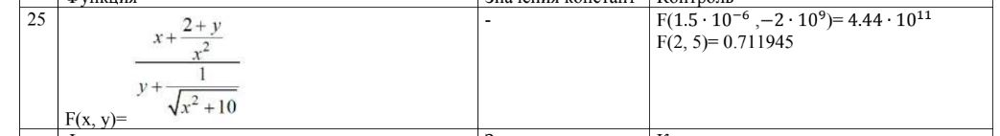
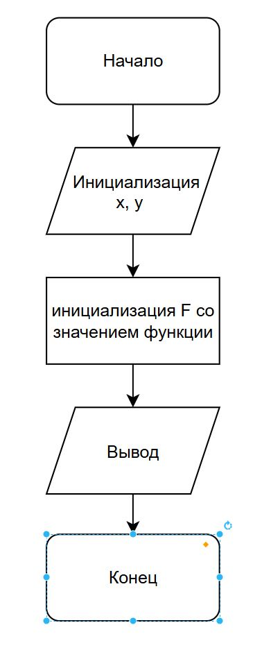

# Домашнее задание к работе 7
____

## Условие задачи
____

Написать программу вычисления значения функции двух переменных.

## 3. Блок-схема

[Ссылка на блок-схему](https://app.diagrams.net/#G1Oywexca7DzU0uVJbJyU7X2ugNYl4dxfq#%7B%22pageId%22%3A%22cTTYPfhQxjpnawyLtHnw%22%7D)

## 4. Информация о разработчике

**Терентьев Максим**
**бТИИ-262**

